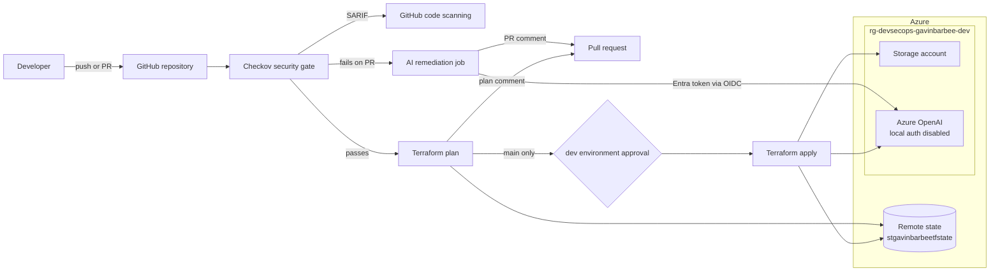

# Azure Terraform DevSecOps Pipeline

**Status:** 🚧 Build in progress

## Video Walkthrough

> 🎥 Loom walkthrough coming soon.

## Project Overview

I built a GitHub Actions pipeline that deploys Azure infrastructure with Terraform behind a real security gate. Every pull request is scanned by Checkov before Terraform is allowed to plan. Findings go to GitHub code scanning as SARIF, and failing PRs get an AI-generated remediation comment from an Azure OpenAI model that the same pipeline deployed. Merges to `main` produce a saved plan that only applies after I approve it on the `dev` environment.

Nothing in the pipeline uses a stored credential:

- **GitHub to Azure:** GitHub Actions authenticates with OIDC federated credentials, so no client secret exists.
- **Terraform state:** state lives in a storage account with shared key access disabled.
- **Azure OpenAI:** API keys are turned off on the account, and every caller, including the pipeline and my local API wrapper, uses an Entra ID token.

### Skills Demonstrated

- **Terraform on Azure:** Terraform with the azurerm 4.x provider, remote state in Azure Blob Storage with Entra ID auth, and a committed lock file for both Windows and Linux.
- **CI/CD design:** a multi-job GitHub Actions pipeline with job dependencies, a concurrency lock on state, PR plan comments, and a saved plan that is applied exactly as reviewed.
- **Keyless authentication:** workload identity federation (OIDC) between GitHub and Microsoft Entra ID, with a separate federated credential for PRs, `main`, and the `dev` environment.
- **Least-privilege RBAC:** the pipeline identity is scoped to one resource group, with data-plane roles only where it needs them.
- **Policy-as-code security gate:** Checkov with a documented exception list, plus SARIF results in GitHub code scanning.
- **Azure OpenAI deployed as code:** the account and model deployment are Terraform resources, local auth is disabled, and calls are authenticated by token.
- **Python automation:** the remediation script reads real scan output, de-duplicates findings, rate-limits calls, and updates a single PR comment in place.
- **Change control:** a GitHub environment with a required reviewer, plus branch protection with required status checks.

## Architecture Diagram



## Prerequisites

- An Azure subscription where I can create role assignments (Owner, or Contributor plus User Access Administrator)
- Azure OpenAI available in the subscription, with quota for a small `GlobalStandard` model deployment in East US 2
- Azure CLI, Terraform 1.9 or later, GitHub CLI, Python 3.12, VS Code
- PowerShell on Windows
- A GitHub account (the repo is public, so code scanning and environment reviewers are free)

## Naming Conventions

| Resource | Name |
|---|---|
| State resource group | `rg-tfstate-gavinbarbee` |
| State storage account | `stgavinbarbeetfstate` |
| State container / key | `tfstate` / `devsecops-pipeline.tfstate` |
| Workload resource group | `rg-devsecops-gavinbarbee-dev` |
| Workload storage account | `stgavinbarbee<8-char suffix>` |
| Azure OpenAI account | `oai-devsecops-gavinbarbee-<8-char suffix>` |
| Model deployment | `chat` |
| App registration | `github-actions-devsecops-pipeline` |
| GitHub environment | `dev` |
| Region | East US 2 (`eastus2`) |

## Project Steps

### 1. Create the repository

```powershell
cd azure-terraform-devsecops-pipeline
git init -b main
gh repo create gavinbarbee/azure-terraform-devsecops-pipeline --public `
  --description "Terraform on Azure through GitHub Actions: OIDC auth, Checkov security gate, and AI remediation with Azure OpenAI" `
  --source . --remote origin
```

### 2. Bootstrap Azure and GitHub

Some things have to exist before Terraform can run: somewhere to keep state, an identity for the pipeline, and its permissions. I put all of that in one idempotent script, [`bootstrap/bootstrap.ps1`](bootstrap/bootstrap.ps1).

```powershell
az login
gh auth login
powershell -ExecutionPolicy Bypass -File .\bootstrap\bootstrap.ps1
```

What it creates:

- **Remote state:** `rg-tfstate-gavinbarbee` and `stgavinbarbeetfstate`, with shared key access disabled, TLS 1.2, and no public blob access. It also creates the `tfstate` container and grants me `Storage Blob Data Contributor`.
- **Workload resource group:** `rg-devsecops-gavinbarbee-dev`. Terraform reads it as a data source instead of creating it, which is what lets the pipeline identity be scoped to it.
- **App registration** `github-actions-devsecops-pipeline`, with three federated credentials. No client secret is ever created. Each GitHub context gets its own credential because the OIDC token's `subject` claim differs:

| Federated credential | Subject | Used by |
|---|---|---|
| `github-pull-requests` | `repo:gavinbarbee/azure-terraform-devsecops-pipeline:pull_request` | PR plan and AI remediation |
| `github-main-branch` | `repo:gavinbarbee/azure-terraform-devsecops-pipeline:ref:refs/heads/main` | Plan on `main` |
| `github-env-dev` | `repo:gavinbarbee/azure-terraform-devsecops-pipeline:environment:dev` | Apply (runs in the `dev` environment) |

- **Least-privilege roles:**

| Principal | Role | Scope |
|---|---|---|
| Pipeline identity | Contributor | Workload resource group |
| Pipeline identity | Storage Blob Data Contributor | State storage account |
| Pipeline identity | Cognitive Services OpenAI User | Workload resource group |
| Me | Storage Blob Data Contributor | State storage account |
| Me | Cognitive Services OpenAI User | Workload resource group |

- **GitHub config:** repo secrets `AZURE_CLIENT_ID`, `AZURE_TENANT_ID`, and `AZURE_SUBSCRIPTION_ID`. These are identifiers, not credentials. It also creates a `dev` environment with me as the required reviewer.

> 📸 Screenshot: app registration → Certificates & secrets → Federated credentials (three entries, no client secrets)

> 📸 Screenshot: role assignments on `rg-devsecops-gavinbarbee-dev`

### 3. Terraform configuration

The configuration lives in [`terraform/`](terraform/). A few decisions worth calling out:

```hcl
provider "azurerm" {
  features {}
  subscription_id                 = var.subscription_id
  resource_provider_registrations = "none"
}
```

The pipeline identity has no subscription-level rights, so the provider can't auto-register resource providers. Bootstrap registers `Microsoft.Storage` and `Microsoft.CognitiveServices` once instead.

```hcl
resource "azurerm_cognitive_account" "openai" {
  kind                  = "OpenAI"
  custom_subdomain_name = "oai-devsecops-gavinbarbee-${local.suffix}"
  local_auth_enabled    = false
  # ...
}
```

With `local_auth_enabled = false`, the account rejects API keys entirely. Entra ID token auth requires a custom subdomain, which is why `custom_subdomain_name` is set. This setup removes any need for a Key Vault to hold an API key, because no key is ever used.

### 4. Initialize locally and commit the lock file

```powershell
cd terraform
Copy-Item terraform.tfvars.example terraform.tfvars
# Set subscription_id in terraform.tfvars
terraform init
terraform providers lock -platform=windows_amd64 -platform=linux_amd64
terraform fmt -recursive
terraform validate
terraform plan "-out=main.tfplan"
cd ..
```

I locked providers for both platforms because I develop on Windows and the pipeline runs on Linux. Without both hashes in `.terraform.lock.hcl`, `terraform init` on the runner would fail. I don't apply locally: the pipeline owns every apply.

> 📸 Screenshot: local `terraform plan` summary

### 5. The security gate

Checkov runs with no `soft_fail`, so any failed check blocks the run. I hardened the storage account to pass as many checks as possible:

- TLS 1.2 only
- HTTPS only
- No public blob access
- Local users disabled
- 7-day blob and container soft delete
- A SAS expiration policy

I also restricted outbound network access on the Azure OpenAI account with an empty allow-list (`outbound_network_access_restricted = true`, no `fqdns`). Checkov's CKV_AZURE_247 only passes when at least one allowed FQDN is listed, so it flags this stricter configuration. I documented it as a false positive rather than allowing a domain the model doesn't need just to satisfy the scanner.

The remaining exceptions are in [`.checkov.yaml`](.checkov.yaml), each with a written reason:

| Check | What it wants | Why it's skipped here |
|---|---|---|
| CKV_AZURE_59, CKV_AZURE_35, CKV2_AZURE_33 | Storage with no public network path | GitHub-hosted runners reach Azure over the internet. Production would use self-hosted runners in a VNet with private endpoints. |
| CKV_AZURE_134 | Azure OpenAI with no public network path | Same reason: the AI remediation job calls the model from a hosted runner |
| CKV_AZURE_247 | Azure OpenAI outbound access restricted with an FQDN allow-list | False positive: outbound is restricted with an empty allow-list, which is stricter than the check accepts |
| CKV2_AZURE_40 | Storage shared key auth disabled | The azurerm provider reads some storage settings with shared key auth |
| CKV_AZURE_206 | Geo-redundant storage | Lab cost |
| CKV2_AZURE_1, CKV2_AZURE_22 | Customer-managed keys | Lab scope; Microsoft-managed keys are used |
| CKV_AZURE_33 | Queue service logging | No queues are used |

Running it locally before pushing:

```powershell
python -m venv .venv
.\.venv\Scripts\Activate.ps1
pip install checkov==3.3.29
checkov --directory terraform --config-file .checkov.yaml
```

### 6. The pipeline

[`.github/workflows/terraform.yml`](.github/workflows/terraform.yml) has four jobs:

| Job | Runs when | What it does |
|---|---|---|
| `Checkov security scan` | Every push, PR, and manual run | Blocking scan. Uploads SARIF to code scanning and saves JSON for the AI job. |
| `AI remediation comment` | Scan **fails** on a PR | Signs in with OIDC, asks Azure OpenAI for a fix per unique check, posts or updates one PR comment |
| `Terraform plan` | Scan **passes** | `fmt -check`, `init`, `validate`, `plan -out=main.tfplan`. Comments the plan on PRs and saves it as an artifact on `main`. |
| `Terraform apply` | Push to `main`, after the plan job | Waits for my approval on the `dev` environment, then applies the saved plan |

The apply job applies the exact plan file I reviewed rather than re-planning. A `concurrency` group keeps two runs from fighting over the state lock.

### 7. First deploy

```powershell
git add .
git status   # confirm no terraform.tfvars, state, .tfplan, or .venv files are staged
git commit -m "feat: initial DevSecOps pipeline, Terraform, and bootstrap"
git push -u origin main
gh run watch
```

The scan and plan pass, and then the apply job waits for review. I approved it in GitHub under Actions → the run → Review deployments.

> 📸 Screenshot: apply job waiting for approval on the `dev` environment

> 📸 Screenshot: successful run with all jobs green

The AI remediation job needs to know where the model lives, so I stored the Terraform outputs as repository variables:

```powershell
cd terraform
gh variable set AZURE_OPENAI_ENDPOINT --body (terraform output -raw openai_endpoint)
gh variable set AZURE_OPENAI_DEPLOYMENT --body (terraform output -raw openai_deployment_name)
cd ..
```

> 📸 Screenshot: Azure OpenAI account → Keys and Endpoint showing local auth disabled

### 8. Branch protection

With the job names registered by the first run, I required both checks on `main`:

```powershell
$protection = @{
    required_status_checks        = @{ strict = $true; contexts = @('Checkov security scan', 'Terraform plan') }
    enforce_admins                = $false
    required_pull_request_reviews = @{ required_approving_review_count = 0 }
    restrictions                  = $null
} | ConvertTo-Json -Depth 5
$protectionFile = Join-Path $env:TEMP 'protection.json'
[System.IO.File]::WriteAllText($protectionFile, $protection)
gh api --method PUT repos/gavinbarbee/azure-terraform-devsecops-pipeline/branches/main/protection --input $protectionFile
Remove-Item $protectionFile
```

### 9. Break and fix: watching the gate work

On a feature branch, I added a real change (a private `reports` container) and slipped in a misconfiguration at the same time:

```hcl
resource "azurerm_storage_container" "reports" {
  name                  = "reports"
  storage_account_id    = azurerm_storage_account.workload.id
  container_access_type = "private"
}
```

```hcl
  allow_nested_items_to_be_public = true   # the misconfiguration
```

```powershell
git checkout -b feature/reports-container
git add terraform/main.tf
git commit -m "feat: add reports container"
git push -u origin feature/reports-container
gh pr create --fill
```

What happened:

1. The Checkov job failed on CKV_AZURE_190 (blob public access), and `Terraform plan` never ran.
2. The finding appeared in the Security tab under code scanning.
3. The AI remediation job posted a comment with the corrected block.
4. I set `allow_nested_items_to_be_public = false` and pushed again. The scan passed, and the plan comment showed exactly one resource to add.
5. I merged, approved the `dev` deployment, and the container was created.

> 📸 Screenshot: failed Checkov check on the PR

> 📸 Screenshot: AI remediation comment

> 📸 Screenshot: code scanning alert for CKV_AZURE_190

> 📸 Screenshot: plan comment after the fix

### 10. Calling the model (optional)

[`app/main.py`](app/main.py) is a small FastAPI wrapper that uses my `az login` session to get a token, so no key is involved here either:

```powershell
cd app
python -m venv .venv
.\.venv\Scripts\Activate.ps1
pip install -r requirements.txt
$env:AZURE_OPENAI_ENDPOINT = (terraform -chdir=..\terraform output -raw openai_endpoint)
$env:AZURE_OPENAI_DEPLOYMENT = (terraform -chdir=..\terraform output -raw openai_deployment_name)
uvicorn main:app --reload
```

In a second terminal:

```powershell
Invoke-RestMethod -Method Post -Uri http://localhost:8000/chat `
  -ContentType 'application/json' `
  -Body (@{ message = 'In one sentence, why use OIDC instead of a client secret in CI/CD?' } | ConvertTo-Json)
```

> 📸 Screenshot: API response

## Verification Checklist

- [ ] App registration has three federated credentials and zero client secrets
- [ ] Pipeline identity has roles only on the workload resource group and the state storage account
- [ ] State storage account has shared key access disabled, and state is written through Entra auth
- [ ] `.terraform.lock.hcl` is committed with Windows and Linux hashes
- [ ] Push to `main` runs scan → plan → apply, and apply waits for approval
- [ ] Azure OpenAI account shows local auth disabled; the model deployment `chat` exists
- [ ] Checkov SARIF results appear in the Security tab under code scanning
- [ ] The break/fix PR was blocked by the gate, received an AI remediation comment, and passed after the fix
- [ ] The plan comment on the PR updates in place rather than duplicating
- [ ] Branch protection requires `Checkov security scan` and `Terraform plan`
- [ ] (Optional) The FastAPI `/chat` endpoint returns a response using token auth

## Troubleshooting

| Issue | Cause | Fix |
|---|---|---|
| | | |

## Cleanup

```powershell
cd terraform
$openAiName = terraform output -raw openai_account_name
terraform destroy
# Azure OpenAI accounts are soft-deleted; purge so the name and quota are released
az cognitiveservices account purge --name $openAiName --resource-group rg-devsecops-gavinbarbee-dev --location eastus2
cd ..
az group delete --name rg-devsecops-gavinbarbee-dev --yes
az group delete --name rg-tfstate-gavinbarbee --yes
$appId = az ad app list --display-name github-actions-devsecops-pipeline --query "[0].appId" -o tsv
az ad app delete --id $appId
```

The repo secrets are left in place. They point at a deleted app registration, so they grant nothing.

## Key Takeaways

- **OIDC removes the secret, but the subject claim is strict.** A job that runs in a GitHub environment presents `environment:dev` instead of the branch ref. PRs present `pull_request`. Each context needs its own federated credential, or login fails.
- **Least privilege changes the Terraform design.** Scoping the pipeline to one resource group meant pre-creating that group, reading it as a data source, and turning off automatic provider registration.
- **A security gate is only real if it can fail.** An advisory scan is easy to ignore. A blocking scan forces every exception to be written down with a reason, and that list becomes documentation.
- **"No stored credentials" has to hold everywhere.** That meant OIDC into Azure, Entra auth for state, and local auth disabled on Azure OpenAI. Keyless auth removed the need for a Key Vault to hold an API key.
- **Apply what was reviewed.** Saving the plan as an artifact and applying that file means the approved change is the one that ships.

---

Built by **Gavin Barbee** · Cloud Engineer · [github.com/gavinbarbee](https://github.com/gavinbarbee) · Time to complete: _updated after build_
